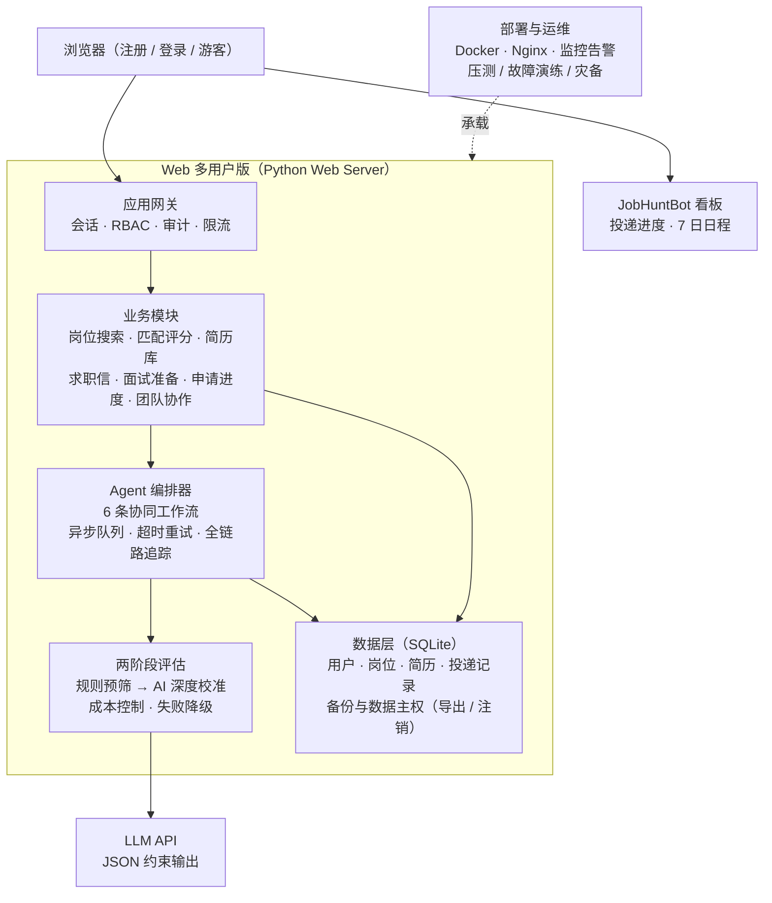
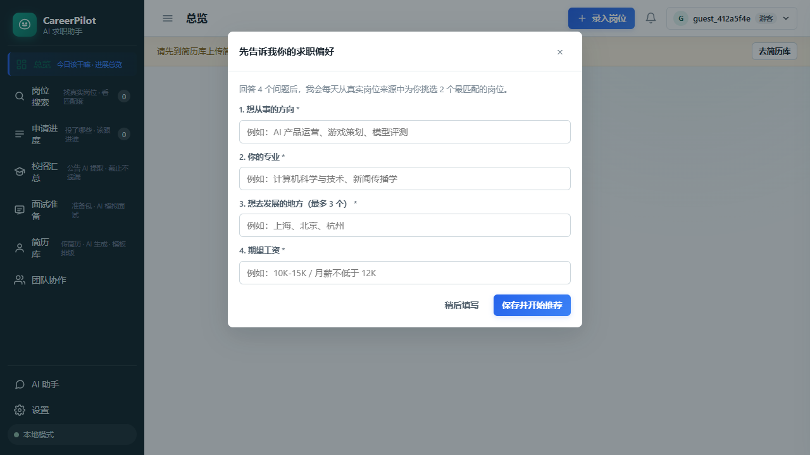
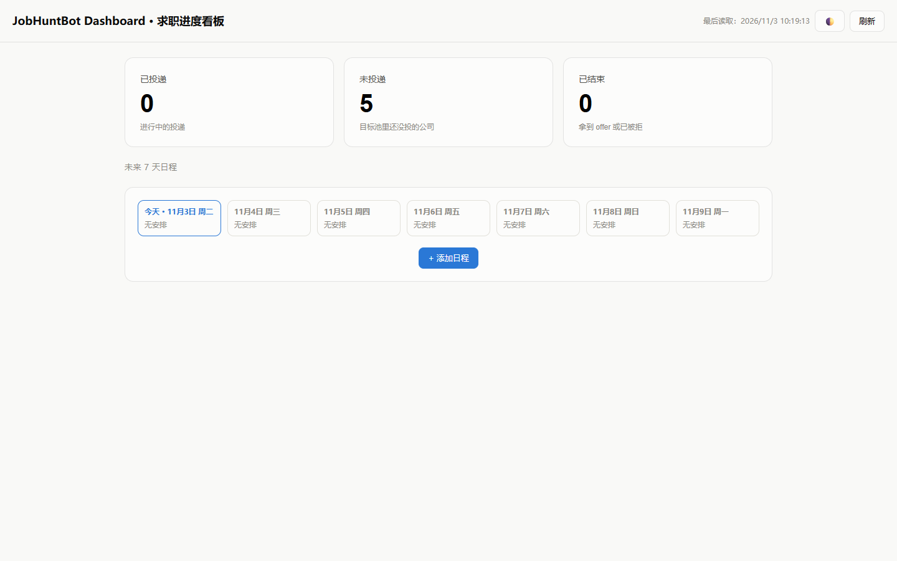

# CareerPilot · 企业级多 Agent AI 求职平台

> 面向中国校招的 **Web 多用户 AI 求职平台**：以 6 条协同 Agent 工作流覆盖「岗位搜索 → 匹配评分 → 简历定制 → 求职信 → 面试准备 → 人工确认」全链路，配套 RBAC / 审计 / 限流、监控告警与压测灾备等企业级加固。已部署上线，支持注册 / 登录 / 游客体验。

> **开源与致谢**：项目源自开源项目 [ai-job-search](https://github.com/ai-job-search-dev/ai-job-search)（GitHub 69k+ stars，MIT License，© Mads Lorentzen）的中文本地化与二次开发，**完整源码见 [CN-students-JOB 仓库](https://github.com/1345815/CN-students-JOB)**（MIT，保留原作者版权声明）。本仓库为脱敏展示仓，不含密钥与个人数据。

---

## 在线演示

| 入口 | 地址 |
| --- | --- |
| Web 多用户主站（注册 / 登录 / 游客） | http://111.230.228.15:8000 |
| 投递进度看板（JobHuntBot Dashboard） | http://111.230.228.15:8420/dashboard.html |

## 核心特性

| 能力 | 说明 |
| --- | --- |
| 6 条 Agent 工作流 | 统一 Agent 协议 + 编排器：岗位搜索 / 匹配评分 / 简历定制 / 求职信 / 面试准备 / 人工确认，支持工具调用、异步队列、超时重试与全链路追踪 |
| 两阶段成本控制 | 「规则预筛 → AI 深度校准」两级评估控制 LLM 调用成本，失败自动降级；结构化 Prompt + LLM JSON 输出约束 |
| Web 多用户版 | 注册 / 登录 / 游客体验、岗位匹配评分、简历与求职信生成、面试准备、申请进度管理、团队协作 |
| 企业级加固 | RBAC 权限、操作审计、限流与分布式会话缓存、无状态水平扩展、监控告警、压测与故障演练、高可用灾备 |
| 数据主权与合规 | 用户数据可导出注销、数据库迁移与发布流程、外部数据源治理 |

## 架构

## 运行实录

> 截图取自线上环境实机运行（游客模式）。

*Web 主应用：总览 / 岗位搜索 / 申请进度 / 校招汇总 / 面试准备 / 简历库 / 团队协作 / AI 助手；首次进入引导式收集求职偏好后开始每日岗位推荐。*

*投递进度看板：已投递 / 未投递 / 已结束统计与未来 7 天日程。*

## 质量与工程化

- **333 项 pytest 自动化测试**（鉴权 / 审计 / 数据主权 / 数据库 PRAGMA / 上游更新检查等专项覆盖），持续扩充
- 约 6,300+ 行 Python 业务代码，另有 Web 前端与脚本工具链
- 企业级改造方法论沉淀为 12 篇工程文档（可观测性 / 迁移发布 / 水平扩展 / RBAC 审计 / 压测灾备 / 数据合规等）
- Docker + Nginx 部署，含 DEPLOY / ROLLBACK / SLO / DR 运行手册

## 技术栈

| 层 | 技术 |
| --- | --- |
| Agent 编排 | 统一 Agent 协议 · 编排器 · Function Calling · 结构化 Prompt · JSON 输出约束 |
| Web 多用户版 | Python Web Server · 会话 / RBAC / 审计 / 限流 · 团队协作 |
| 数据 | SQLite（PRAGMA 调优）· 备份 / 恢复 · 数据主权（导出 / 注销） |
| 部署 | Docker · Nginx · 监控告警 · 压测与故障演练 |

## 相关仓库

- **完整源码（MIT 开源）**：[1345815/CN-students-JOB](https://github.com/1345815/CN-students-JOB)
- 桌面端 AI 编程工作台（实习研发）：[1345815/MAYSIS](https://github.com/1345815/MAYSIS)
